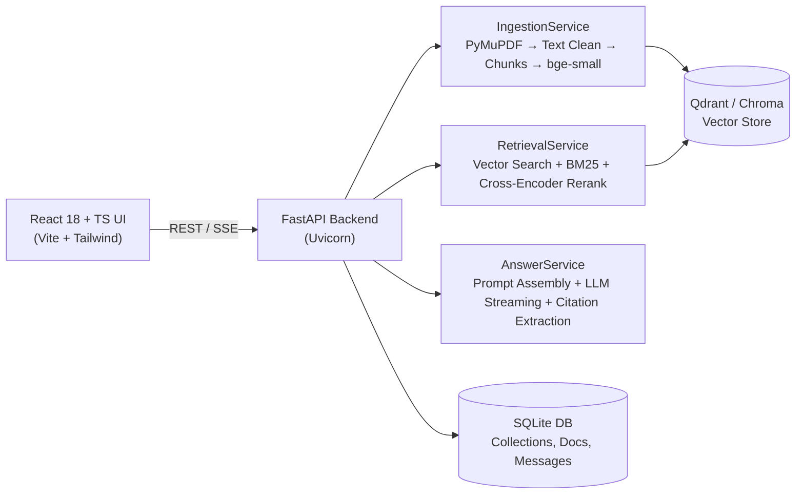
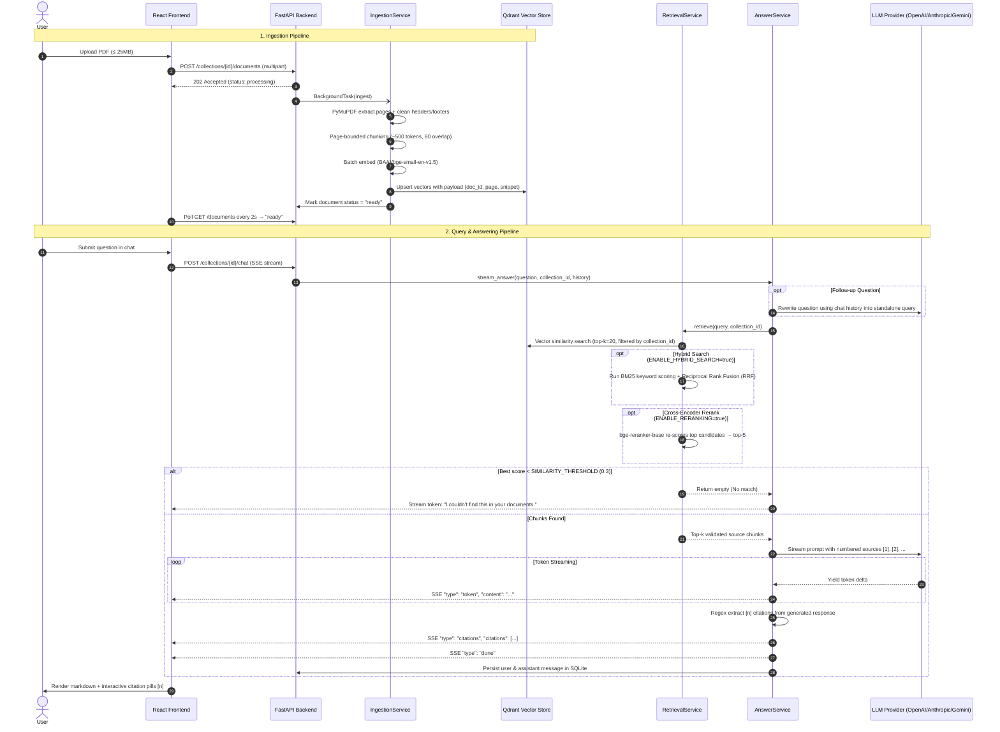

# ResearchVault 🔬

> Upload research papers, ask questions, get answers with page-level citations.

A local RAG (Retrieval-Augmented Generation) research assistant that lets you chat with your PDF collection. Drop in papers, ask questions in natural language, and receive answers grounded in the exact pages that support them.

---

## Demo


> ⚠️ *Add a screen recording of the app here. Export as `docs/demo.gif` (≤ 5 MB) or link a hosted video.*

---

## Architecture



---

## 🔍 How It Works: Step-by-Step Breakdown

ResearchVault operates across three coordinated pipelines: **Ingestion**, **Retrieval**, and **Grounded Answering**.



### 1. Document Ingestion Pipeline
When a PDF is uploaded to a collection:
1. **Validation & Isolation**: The file format is verified (`application/pdf`) and capped at 25 MB (`MAX_UPLOAD_SIZE_MB`). The file is stored using a generated UUID to prevent filesystem collisions and path traversal attacks.
2. **Text Extraction & Page Preserving**: PyMuPDF (`fitz`) parses text per physical page, indexing page numbers starting at page 1.
3. **Automated Noise Removal**:
   - **Header/Footer Stripping**: A heuristic scans lines $\le 60$ characters that appear in $\ge 30\%$ of pages (such as journal headers, dates, and page numbers) and filters them out.
   - **Hyphenation Healing**: Hyphenated line wraps common in two-column scientific papers (e.g., `trans-\nformer`) are automatically merged into clean single tokens (`transformer`).
4. **Page-Bounded Chunking**:
   - Text is segmented into chunks of $\sim 500$ tokens with an $80$-token sliding overlap.
   - **Crucial Rule**: Chunks *never* cross a physical page boundary, ensuring every citation badge points to an unequivocal page number.
5. **Local Vectorization**: Chunks are embedded in batches using `BAAI/bge-small-en-v1.5` (a lightweight 384-dimensional dense representation model running locally on CPU/GPU without external API latency or costs).
6. **Vector Database Upsert**: Points are inserted into Qdrant (or Chroma fallback) tagged with collection payload filters:
   ```json
   {
     "doc_id": "9b1deb4d-3b7d-4bad-9bdd-2b0d7b3dcb6d",
     "collection_id": "c1f6d3f2-8c7a-4c22-9f33-1b9d4e5f6a7b",
     "filename": "attention-is-all-you-need.pdf",
     "page": 3,
     "chunk_index": 2,
     "text": "The Transformer uses multi-head attention in two different ways..."
   }
   ```
7. **Status Notification**: The SQLite record updates from `processing` to `ready`. The frontend polls every 2 seconds to update the UI badge in real time.

---

### 2. Multi-Stage Retrieval & Quality Gating
When a user asks a question:
1. **Query Rewriting**: If previous chat turns exist, a lightweight LLM call converts contextual follow-ups (e.g., *"What did they compare it against?"*) into self-contained search queries (e.g., *"What baseline models was the Transformer compared against in the paper?"*).
2. **Dense Vector Search**: The rewritten query is vectorized using `bge-small` and queried against Qdrant with a strict metadata filter (`collection_id == current_collection`), retrieving the top 20 candidate passages.
3. **Hybrid Search with BM25 (Optional)**:
   - When `ENABLE_HYBRID_SEARCH=true`, an in-memory BM25 index scores keyword overlaps on the candidate set.
   - Scores are fused via **Reciprocal Rank Fusion (RRF)**:
     $$\text{RRF Score}(d) = \frac{1}{60 + \text{rank}_{\text{dense}}(d)} + \frac{1}{60 + \text{rank}_{\text{BM25}}(d)}$$
4. **Cross-Encoder Reranking (Optional)**:
   - When `ENABLE_RERANKING=true`, candidates are evaluated by a deep cross-encoder model (`BAAI/bge-reranker-base`) comparing `(query, passage)` pairs directly, isolating the top 5 most contextually relevant chunks.
5. **Hallucination Shield (Similarity Threshold)**:
   - If the best similarity score is below `SIMILARITY_THRESHOLD` ($0.3$), the retrieval phase short-circuits.
   - The assistant immediately replies: `"I couldn't find this in your documents."` rather than guessing or hallucinating using parametric knowledge.

---

### 3. Source-Grounded Answering & Citation Mapping
When relevant passages pass the retrieval threshold:
1. **Prompt Assembly & Injection Defense**:
   - The system prompt instructs the LLM to act strictly as a research assistant.
   - Chunks are formatted into numbered blocks:
     ```text
     Source [1] (File: attention.pdf, Page 3):
     "The Transformer uses multi-head attention..."

     Source [2] (File: attention.pdf, Page 5):
     "Table 1 shows BLEU scores on WMT 2014 English-to-German..."
     ```
   - Sources are tagged as untrusted data with strict instructions to ignore any instruction overrides embedded inside PDFs.
2. **Streaming Generation**: Tokens are streamed back to the client over an HTTP `text/event-stream` (SSE) connection in real time.
3. **Citation Extraction**:
   - As tokens complete, the backend parses `[1]`, `[2]` citation markers from the generated answer.
   - A final JSON event is sent containing the exact citation mapping:
     ```json
     data: {"type": "citations", "citations": [
       {"index": 1, "doc_id": "...", "filename": "attention.pdf", "page": 3, "snippet": "The Transformer uses multi-head attention..."},
       {"index": 2, "doc_id": "...", "filename": "attention.pdf", "page": 5, "snippet": "Table 1 shows BLEU scores..."}
     ]}
     ```
4. **Persistence**: The question, generated answer, and citation metadata are persisted to SQLite so chat history survives page refreshes and server reboots.

---

### 4. Interactive Frontend Experience
1. **Clickable Citations**: In the React chat window, `react-markdown` parses the assistant's response and renders citation markers (like `[1]`, `[2]`) as interactive, stylized indigo badges.
2. **Slide-In Citation Drawer**: Clicking any citation badge slides in an inspection drawer from the right, showing:
   - The exact source PDF filename.
   - The precise physical page number.
   - The verbatim snippet of text extracted during ingestion.
3. **Live Feedback**: Drag-and-drop file uploader displays instantaneous feedback, file size guardrails, and active background processing spinners.

---

## Tech Stack

| Layer | Technology |
|---|---|
| **Frontend** | React 18, Vite, Tailwind CSS, shadcn/ui |
| **Backend** | Python 3.11+, FastAPI, SQLModel, Pydantic v2 |
| **Vector DB** | Qdrant (Docker) |
| **Relational DB** | SQLite (via SQLModel) |
| **Embeddings** | `BAAI/bge-small-en-v1.5` (sentence-transformers, local) |
| **LLM** | OpenAI (`gpt-4o-mini` default), Anthropic Claude, Google Gemini |
| **PDF parsing** | PyMuPDF (fitz) |
| **Hybrid search** | BM25 (rank_bm25) + dense vector fusion |
| **Reranking** | cross-encoder (`BAAI/bge-reranker-base`) via sentence-transformers |
| **Containerisation** | Docker Compose |

---

## Quick Start

### Prerequisites

- Docker & Docker Compose
- Node.js ≥ 18
- Python ≥ 3.11

### 3-command setup

```bash
# 1. Configure your API key
cp backend/.env.example backend/.env
# → open backend/.env and fill in OPENAI_API_KEY (or ANTHROPIC_API_KEY / GEMINI_API_KEY)

# 2. Start Qdrant + backend
docker compose up -d

# 3. Start the frontend dev server
cd frontend && npm install && npm run dev
```

Open [http://localhost:5173](http://localhost:5173) in your browser.

> [!TIP]
> The backend API is available at `http://localhost:8000`. Visit `http://localhost:8000/docs` for the interactive Swagger UI.

> [!NOTE]
> On first run, `sentence-transformers` will download the embedding model (~130 MB). Subsequent starts use the cached model.

---

## Features

- 📄 **Multi-collection workspace** — organise papers into separate collections (e.g., by project or topic)
- ⚡ **Fast local ingestion** — PyMuPDF text extraction, sliding-window chunking, local embedding (no API call required)
- 🔍 **Hybrid retrieval** — dense vector search + BM25 keyword search, fused with Reciprocal Rank Fusion (RRF)
- 🎯 **Cross-encoder reranking** — optional second-stage reranking with a local MS MARCO cross-encoder
- 💬 **Streaming chat** — real-time token streaming via Server-Sent Events
- 📌 **Page-level citations** — every answer links back to the exact page and snippet in the source PDF
- 🔄 **Multi-turn conversation** — history is passed to the LLM for follow-up questions
- 🗄️ **Persistent history** — all messages stored in SQLite, survives restarts
- 🔀 **Pluggable LLM** — switch between OpenAI, Anthropic, and Gemini via a single env var

---

## Evaluation Results

Run the evaluation harness against your own papers to populate this table:

| Method | Hit@5 | MRR | Latency p50 | Latency p95 |
|---|---|---|---|---|
| Vector only | — | — | — | — |
| Vector + BM25 | — | — | — | — |
| Vector + BM25 + Rerank | — | — | — | — |

> *Run `python eval/run_eval.py --api http://localhost:8000 --collection-id <UUID> --questions eval/questions.json` to populate this table with your data.*

### Running the eval harness

```bash
# Install eval dependency (httpx)
pip install httpx

# Run against a live server
python eval/run_eval.py \
    --api http://localhost:8000 \
    --collection-id <your-collection-uuid> \
    --questions eval/questions.json \
    --top-k 5 \
    --output eval/results.json
```

Edit `eval/questions.json` to add your own ground-truth Q&A pairs before running.

---

## API Reference

All endpoints are served at `http://localhost:8000`. Full interactive docs: `/docs`.

### Collections

| Method | Path | Description |
|---|---|---|
| `POST` | `/collections` | Create a new collection |
| `GET` | `/collections` | List all collections |

### Documents

| Method | Path | Description |
|---|---|---|
| `POST` | `/collections/{id}/documents` | Upload a PDF (≤ 25 MB, `multipart/form-data`) |
| `GET` | `/collections/{id}/documents` | List documents in a collection |
| `DELETE` | `/documents/{doc_id}` | Delete a document |

### Chat

| Method | Path | Description |
|---|---|---|
| `POST` | `/collections/{id}/chat` | Stream a chat response (SSE) |

### Health

| Method | Path | Description |
|---|---|---|
| `GET` | `/health` | Returns `{"status": "ok", "version": "0.1.0"}` |

#### Chat SSE event format

The `/chat` endpoint returns `text/event-stream`. Events:

```
data: {"type": "token", "content": "The paper proposes..."}\n\n
data: {"type": "token", "content": " a novel"}\n\n
data: {"type": "citations", "citations": [
    {"index": 1, "doc_id": "...", "filename": "paper1.pdf", "page": 3, "snippet": "..."}
  ]}\n\n
data: [DONE]\n\n
```

---

## Configuration

All configuration is via `backend/.env` (see `backend/.env.example`):

| Variable | Default | Description |
|---|---|---|
| `VECTOR_STORE` | `qdrant` | Vector store backend (`qdrant` or `chroma`) |
| `QDRANT_URL` | `http://localhost:6333` | Qdrant service URL |
| `EMBEDDING_MODEL` | `BAAI/bge-small-en-v1.5` | HuggingFace embedding model |
| `LLM_PROVIDER` | `openai` | LLM provider (`openai`, `anthropic`, `gemini`) |
| `LLM_MODEL` | `gpt-4o-mini` | Model name for the chosen provider |
| `OPENAI_API_KEY` | _(required)_ | OpenAI API key |
| `ANTHROPIC_API_KEY` | | Anthropic API key |
| `GEMINI_API_KEY` | | Google Gemini API key |
| `ENABLE_HYBRID_SEARCH` | `false` | Enable BM25 + vector fusion |
| `ENABLE_RERANKING` | `false` | Enable cross-encoder reranking |
| `RETRIEVAL_TOP_K` | `20` | Candidates fetched before reranking |
| `RERANK_TOP_K` | `5` | Final chunks passed to LLM |
| `MAX_UPLOAD_SIZE_MB` | `25` | PDF upload size limit |

---

## Limitations & Future Work

### v1 limitations

- **No authentication** — single-user, local only. Do not expose to the internet.
- **No OCR** — scanned PDFs (image-only) are not supported; text must be selectable.
- **No multi-user** — a single SQLite database, no user isolation.
- **English-optimised** — the default embedding model and reranker are trained on English text.

### Future work

- 🌐 Web scraping ingestion (arXiv, Semantic Scholar, DOI resolver)
- 🕸️ Citation graph visualisation
- 🔐 Authentication & multi-user support (JWT + per-user collections)
- 🧠 Fine-tuning embedding model on domain-specific data
- 📊 Chunk-level confidence scores displayed in UI
- 🖼️ OCR support via Tesseract / Surya for scanned PDFs
- 📤 Export annotated answers to Markdown / Notion / Obsidian

---

## Resume Bullet

> "Built a local RAG research assistant with FastAPI + Qdrant + React; improved retrieval hit@5 from X% to Y% by adding BM25 hybrid search and cross-encoder reranking."

---

## Project Structure

```
.
├── backend/
│   ├── app/
│   │   ├── main.py          # FastAPI app, CORS, startup
│   │   ├── config.py        # pydantic-settings config
│   │   ├── api/             # Route handlers
│   │   ├── services/        # Ingestion, Retrieval, Answer, LLM
│   │   ├── stores/          # VectorStore ABC + Qdrant/Chroma impls
│   │   └── models/          # SQLModel DB models + Pydantic schemas
│   ├── tests/
│   ├── requirements.txt
│   └── .env.example
├── frontend/
│   ├── src/
│   │   ├── components/      # React components
│   │   ├── hooks/           # Custom hooks (useChat, useCollections, …)
│   │   └── api/             # API client, SSE stream, types
│   └── package.json
├── eval/
│   ├── questions.json       # Ground-truth Q&A pairs for evaluation
│   └── run_eval.py          # Evaluation harness (Hit@K, MRR, latency)
├── docker-compose.yml
└── README.md
```

---

## License

MIT © 2024 — see [LICENSE](LICENSE) for details.
