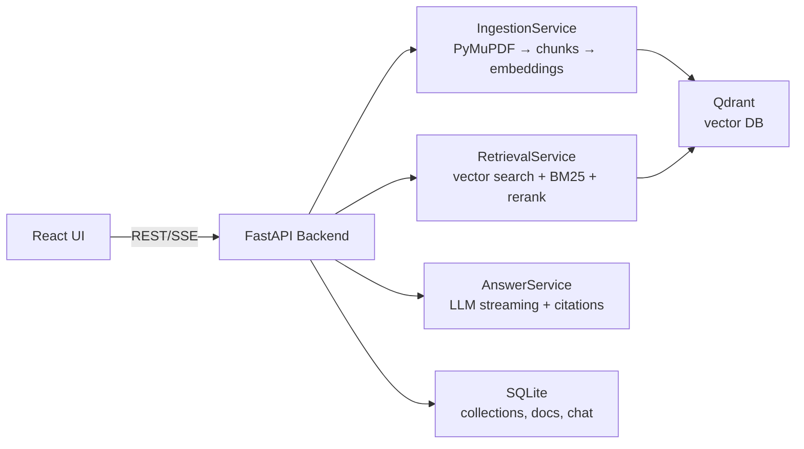

# ResearchVault 🔬

> Upload research papers, ask questions, get answers with page-level citations.

A local RAG (Retrieval-Augmented Generation) research assistant that lets you chat with your PDF collection. Drop in papers, ask questions in natural language, and receive answers grounded in the exact pages that support them.

---

## Demo


> ⚠️ *Add a screen recording of the app here. Export as `docs/demo.gif` (≤ 5 MB) or link a hosted video.*

---

## Architecture



**Request lifecycle:**
1. User uploads a PDF → `IngestionService` extracts text with PyMuPDF, chunks it, embeds it with `BAAI/bge-small-en-v1.5`, and upserts vectors into Qdrant.
2. User asks a question → `RetrievalService` runs dense vector search (+ optional BM25 hybrid) and optional cross-encoder reranking.
3. Top chunks are injected into the prompt → `AnswerService` streams the LLM response back via Server-Sent Events, appending a `citations` event at the end.

---

## Tech Stack

| Layer | Technology |
|---|---|
| **Frontend** | React 18, Vite, Tailwind CSS, shadcn/ui |
| **Backend** | Python 3.11+, FastAPI, SQLModel, Pydantic v2 |
| **Vector DB** | Qdrant (Docker) |
| **Relational DB** | SQLite (via SQLModel) |
| **Embeddings** | `BAAI/bge-small-en-v1.5` (sentence-transformers, local) |
| **LLM** | OpenAI (`gpt-4o-mini` default), Anthropic Claude, Google Gemini |
| **PDF parsing** | PyMuPDF (fitz) |
| **Hybrid search** | BM25 (rank_bm25) + dense vector fusion |
| **Reranking** | cross-encoder (`BAAI/bge-reranker-base`) via sentence-transformers |
| **Containerisation** | Docker Compose |

---

## Quick Start

### Prerequisites

- Docker & Docker Compose
- Node.js ≥ 18
- Python ≥ 3.11

### 3-command setup

```bash
# 1. Configure your API key
cp backend/.env.example backend/.env
# → open backend/.env and fill in OPENAI_API_KEY (or ANTHROPIC_API_KEY / GEMINI_API_KEY)

# 2. Start Qdrant + backend
docker compose up -d

# 3. Start the frontend dev server
cd frontend && npm install && npm run dev
```

Open [http://localhost:5173](http://localhost:5173) in your browser.

> [!TIP]
> The backend API is available at `http://localhost:8000`. Visit `http://localhost:8000/docs` for the interactive Swagger UI.

> [!NOTE]
> On first run, `sentence-transformers` will download the embedding model (~130 MB). Subsequent starts use the cached model.

---

## Features

- 📄 **Multi-collection workspace** — organise papers into separate collections (e.g., by project or topic)
- ⚡ **Fast local ingestion** — PyMuPDF text extraction, sliding-window chunking, local embedding (no API call required)
- 🔍 **Hybrid retrieval** — dense vector search + BM25 keyword search, fused with Reciprocal Rank Fusion (RRF)
- 🎯 **Cross-encoder reranking** — optional second-stage reranking with a local MS MARCO cross-encoder
- 💬 **Streaming chat** — real-time token streaming via Server-Sent Events
- 📌 **Page-level citations** — every answer links back to the exact page and snippet in the source PDF
- 🔄 **Multi-turn conversation** — history is passed to the LLM for follow-up questions
- 🗄️ **Persistent history** — all messages stored in SQLite, survives restarts
- 🔀 **Pluggable LLM** — switch between OpenAI, Anthropic, and Gemini via a single env var

---

## Evaluation Results

Run the evaluation harness against your own papers to populate this table:

| Method | Hit@5 | MRR | Latency p50 | Latency p95 |
|---|---|---|---|---|
| Vector only | — | — | — | — |
| Vector + BM25 | — | — | — | — |
| Vector + BM25 + Rerank | — | — | — | — |

> *Run `python eval/run_eval.py --api http://localhost:8000 --collection-id <UUID> --questions eval/questions.json` to populate this table with your data.*

### Running the eval harness

```bash
# Install eval dependency (httpx)
pip install httpx

# Run against a live server
python eval/run_eval.py \
    --api http://localhost:8000 \
    --collection-id <your-collection-uuid> \
    --questions eval/questions.json \
    --top-k 5 \
    --output eval/results.json
```

Edit `eval/questions.json` to add your own ground-truth Q&A pairs before running.

---

## API Reference

All endpoints are served at `http://localhost:8000`. Full interactive docs: `/docs`.

### Collections

| Method | Path | Description |
|---|---|---|
| `POST` | `/collections` | Create a new collection |
| `GET` | `/collections` | List all collections |

### Documents

| Method | Path | Description |
|---|---|---|
| `POST` | `/collections/{id}/documents` | Upload a PDF (≤ 25 MB, `multipart/form-data`) |
| `GET` | `/collections/{id}/documents` | List documents in a collection |
| `DELETE` | `/documents/{doc_id}` | Delete a document |

### Chat

| Method | Path | Description |
|---|---|---|
| `POST` | `/collections/{id}/chat` | Stream a chat response (SSE) |

### Health

| Method | Path | Description |
|---|---|---|
| `GET` | `/health` | Returns `{"status": "ok", "version": "0.1.0"}` |

#### Chat SSE event format

The `/chat` endpoint returns `text/event-stream`. Events:

```
data: {"type": "token", "content": "The paper proposes..."}\n\n
data: {"type": "token", "content": " a novel"}\n\n
data: {"type": "citations", "citations": [
    {"index": 1, "doc_id": "...", "filename": "paper1.pdf", "page": 3, "snippet": "..."}
  ]}\n\n
data: [DONE]\n\n
```

---

## Configuration

All configuration is via `backend/.env` (see `backend/.env.example`):

| Variable | Default | Description |
|---|---|---|
| `VECTOR_STORE` | `qdrant` | Vector store backend (`qdrant` or `chroma`) |
| `QDRANT_URL` | `http://localhost:6333` | Qdrant service URL |
| `EMBEDDING_MODEL` | `BAAI/bge-small-en-v1.5` | HuggingFace embedding model |
| `LLM_PROVIDER` | `openai` | LLM provider (`openai`, `anthropic`, `gemini`) |
| `LLM_MODEL` | `gpt-4o-mini` | Model name for the chosen provider |
| `OPENAI_API_KEY` | _(required)_ | OpenAI API key |
| `ANTHROPIC_API_KEY` | | Anthropic API key |
| `GEMINI_API_KEY` | | Google Gemini API key |
| `ENABLE_HYBRID_SEARCH` | `false` | Enable BM25 + vector fusion |
| `ENABLE_RERANKING` | `false` | Enable cross-encoder reranking |
| `RETRIEVAL_TOP_K` | `20` | Candidates fetched before reranking |
| `RERANK_TOP_K` | `5` | Final chunks passed to LLM |
| `MAX_UPLOAD_SIZE_MB` | `25` | PDF upload size limit |

---

## Limitations & Future Work

### v1 limitations

- **No authentication** — single-user, local only. Do not expose to the internet.
- **No OCR** — scanned PDFs (image-only) are not supported; text must be selectable.
- **No multi-user** — a single SQLite database, no user isolation.
- **English-optimised** — the default embedding model and reranker are trained on English text.

### Future work

- 🌐 Web scraping ingestion (arXiv, Semantic Scholar, DOI resolver)
- 🕸️ Citation graph visualisation
- 🔐 Authentication & multi-user support (JWT + per-user collections)
- 🧠 Fine-tuning embedding model on domain-specific data
- 📊 Chunk-level confidence scores displayed in UI
- 🖼️ OCR support via Tesseract / Surya for scanned PDFs
- 📤 Export annotated answers to Markdown / Notion / Obsidian

---

## Resume Bullet

> "Built a local RAG research assistant with FastAPI + Qdrant + React; improved retrieval hit@5 from X% to Y% by adding BM25 hybrid search and cross-encoder reranking."

---

## Project Structure

```
researchvault/
├── backend/
│   ├── app/
│   │   ├── main.py          # FastAPI app, CORS, startup
│   │   ├── config.py        # pydantic-settings config
│   │   ├── api/             # Route handlers
│   │   ├── services/        # Ingestion, Retrieval, Answer, LLM
│   │   ├── stores/          # VectorStore ABC + Qdrant/Chroma impls
│   │   └── models/          # SQLModel DB models + Pydantic schemas
│   ├── tests/
│   ├── requirements.txt
│   └── .env.example
├── frontend/
│   ├── src/
│   │   ├── components/      # React components
│   │   ├── hooks/           # Custom hooks (useChat, useCollections, …)
│   │   └── lib/             # API client, utilities
│   └── package.json
├── eval/
│   ├── questions.json       # Ground-truth Q&A pairs for evaluation
│   └── run_eval.py          # Evaluation harness (Hit@K, MRR, latency)
├── docs/
│   └── demo.gif             # (add your screen recording here)
└── docker-compose.yml
```

---

## License

MIT © 2024 — see [LICENSE](LICENSE) for details.
